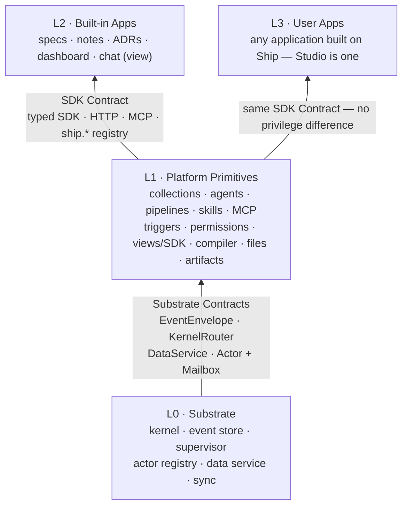

# Architecture Charter

This document defines what Ship's architecture *should* be. Read it before any change that crosses module or layer lines. For the codebase as it currently stands, see [runtime-model](./runtime-model.md) and [runtime](./runtime.md); for the authentication boundary, see [auth-model](./auth-model.md).

## What Ship is

**For users**: Ship enables anyone to create custom applications and run them locally. Bring your own AI, leverage platform services to build complex features fast.

**For contributors**: Ship is a local-first application framework + runtime. Platform primitives are consumed by built-in and user applications through one typed SDK. AI is BYO at the runtime layer (provider-agnostic agents) and opt-in at the application layer.

## The four layers

**L0 · Substrate.** Kernel, event store, supervisor, actor registry, data service, cloud sync, HTTP server, auth. Owns trait surfaces. Knows nothing about app concepts.

**L1 · Platform Primitives.** Reusable building blocks: collections, agents (built on actors), pipelines, skills, MCP, triggers, permissions, rules, views/SDK, compiler, files, artifacts, git, settings. Each declares its inputs as a typed schema; each is consumed through the SDK contract.

**L2 · Built-in Apps.** Ship-shipped applications: specs, notes, ADRs, dashboard, the chat view. They consume L1 only — *the same SDK any L3 app uses*. No `services::*` shortcuts. First-party in origin, third-party in posture.

**L3 · User Applications.** Anything anyone builds on Ship, including Studio. Has only the SDK to reach the platform.

**Placement rule**: L1 if any app could plausibly want it. L2 if it's a single concrete app surface. L3 if it's a complete user-facing application.

## Contracts

The contracts are the architecture. The layers are just where things happen to live.

**SDK Contract (L1↔L2 and L1↔L3).** One typed SDK generated from one operation descriptor. Three faces: HTTP routes, MCP tools, the `ship.*` view registry. L2 and L3 consume L1 only through this surface; the wire is the same for both. The descriptor is the source of truth — drift between descriptor and any face fails CI.

**Substrate Contracts (L0↔L1).** `EventEnvelope`, `KernelRouter`, `DataService`, `Actor` + `Mailbox`, `Supervisor`. L1 primitives use only these traits. No raw sqlx. No direct process spawning. No kernel-bypassing writes.

**The compiler is special.** Of all L1 primitives, the compiler is the only one that legitimately reaches across the L1 surface — skill templates pull from collections, agent profiles compose skills + permissions + MCP into provider configs, view compilation reads multiple primitives. Treat it as a glue primitive and document its dependencies explicitly. New providers (subscription CLIs, headless modes, local LLMs, our own models) plug in here as emitters; the abstractions above and below stay provider-agnostic.

## Non-negotiables

1. **L2 has no privileged access.** Built-in apps consume the same SDK as user apps.
2. **Event-sourced storage by default.** Other storage requires a registered exception with a written reason.
3. **One contract per boundary, one source of truth.** Drift between contract and code fails CI.
4. **Hard file cap: 400 lines.** Override with explicit `// FILE_CAP_OVERRIDE: <reason>` only when genuinely warranted.

## Agents are actors

The actor abstraction is **L0** — supervised long-lived processes with a mailbox-shaped envelope-in / envelope-out boundary, lifecycle events on the kernel. **Agents are an L1 primitive built on actors.**

The flow: agent profile (declarative, schema-defined at L1) → compiler emits provider config (Claude, Codex, Gemini, OpenCode, Cursor — and eventually local/custom backends) → supervisor dispatches the actor instance → kernel routes envelopes through the mailbox.

Provider differences live entirely in the compiler. Subscription vs API vs self-hosted is a backend selection at compile time, transparent to the actor abstraction. Adding a new provider means a compiler emitter, not changes to the substrate or to the L1 primitives that compose agents (skills, permissions, MCP).

## CHANGELOG

- 2026-04-29 · Initial draft. Codifies the layering surfaced by the SpecsService → CollectionsService consolidation. Companion to [runtime-model](./runtime-model.md).
